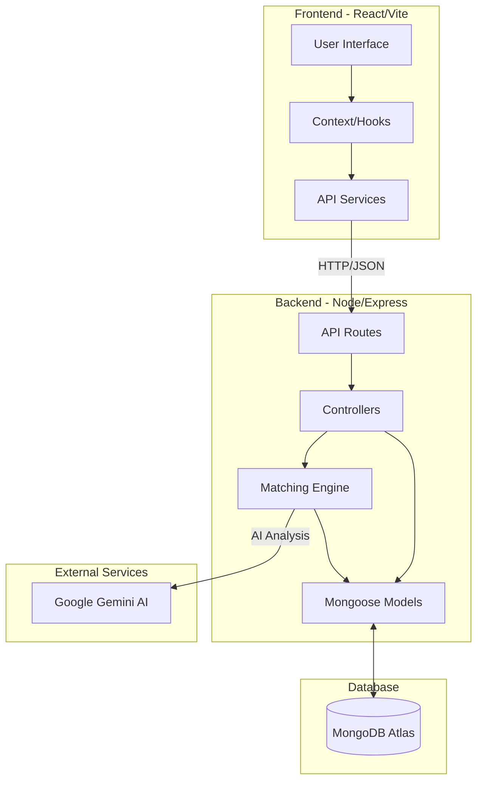

# ImpactMatchNGO

This project is a high-impact Volunteer Management System designed to bridge the gap between NGOs and field workers by automating resource allocation and data verification.

This document provides a high-level overview of the ImpactMatch project structure and its architectural components.

## Project Structure

```text
ImpactMatchNGO/
├── backend/                # Express.js Server
│   ├── src/
│   │   ├── config/         # Database and environment configurations
│   │   ├── controllers/    # Request handlers and logic
│   │   ├── middleware/     # Auth and validation middleware
│   │   ├── models/         # Mongoose schemas/models
│   │   ├── routes/         # API endpoint definitions
│   │   ├── services/       # Business logic (Matching Engine, Gemini API)
│   │   └── index.js        # Entry point
│   ├── package.json
│   └── .env
├── frontend/               # React + Vite + Tailwind Client
│   ├── src/
│   │   ├── components/     # Reusable UI components
│   │   ├── context/        # State management (Auth context)
│   │   ├── hooks/          # Custom React hooks
│   │   ├── pages/          # Main page views
│   │   ├── services/       # API call handlers
│   │   ├── App.tsx         # Main component / Router
│   │   └── main.tsx        # React entry point
│   ├── package.json
│   └── .env
├── render.yaml             # Render deployment configuration
└── README.md
```

## Architectural Diagram



## Getting Started

### Backend Setup
1. `cd backend`
2. `npm install`
3. Create a `.env` file with your credentials.
4. `npm run dev`

### Frontend Setup
1. `cd frontend`
2. `npm install`
3. Create a `.env` file with your API URL.
4. `npm run dev`

## Key Features
- **AI Matching Engine**: Periodically matches needs with available resources using Gemini AI.
- **Role-Based Access**: Specialized dashboards for NGOs, Volunteers, and Donors.
- **Location Awareness**: GPS detection and address geocoding for better field operations.
