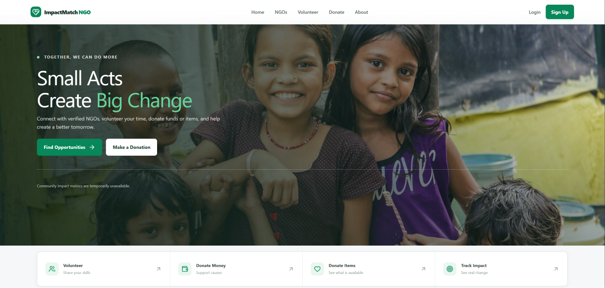

# Impact Match

Impact Match connects people who want to help with verified nonprofits that need volunteers or donations. The initial MVP includes account roles, NGO verification, searchable opportunities, volunteer sign-ups, Razorpay test-mode donations, and a personal impact summary.

## App preview



## Stack

- **Client:** React, TypeScript, Vite, Tailwind CSS, accessible shadcn/ui-style components, Lucide, Framer Motion, React Router, TanStack Query, React Hook Form, and Zod.
- **API:** Node.js, Express, MongoDB/Mongoose, bcrypt password hashing, Mongo-backed secure sessions, Helmet, CORS, and rate limiting.
- **Payments:** Razorpay orders and signed payment verification; the server does not trust client-supplied payment totals.
- **Quality:** Vitest, Supertest, Playwright, and Swagger UI.

## Run locally

Requirements: Node.js 20.19+ or 22.12+, npm, and MongoDB 6+ (local or Atlas).

1. In PowerShell, copy the example configuration and edit it: `Copy-Item server\.env.example server\.env`. Set a random `SESSION_SECRET` of at least 32 characters and configure `MONGODB_URI`. If omitted in development/test, a fresh random session secret is generated at startup (sessions do not survive restart). `SESSION_TTL_DAYS` is optional and defaults to 14 (allowed range: 1–30).
2. To enable Razorpay, configure the Test Mode `RAZORPAY_KEY_ID`, `RAZORPAY_KEY_SECRET`, and `RAZORPAY_WEBHOOK_SECRET` together. The server rejects live-mode keys.
3. Optionally set `ADMIN_EMAIL` and `ADMIN_PASSWORD` before first startup to create an administrator for NGO review.
4. Open PowerShell at the repository root (the folder containing this `package.json`) and install the workspace dependencies once:

   ```powershell
   npm install
   ```

Do not run separate `npm install` commands inside `client\` or `server\`; this repository is an npm-workspaces monorepo. If install reports `Cannot read properties of null (reading 'edgesOut')`, first confirm you are at the repository root and check `node --version` (20.19+ or 22.12+) and `npm --version`; then retry `npm install` from the root. Do not delete lockfiles or clear caches as a first step.

Run the API and frontend in separate PowerShell terminals, both opened at the repository root:

```powershell
# Terminal 1: builds the API, then starts it
npm start

# Terminal 2: starts the Vite frontend
npm run dev
```

`npm start` builds the server before running it, so it can also be used after a clean checkout. `npm run dev` starts only the client; use `npm run dev:all` if you want the existing helper to start both development servers together. The client runs at <http://localhost:5173>, the API at <http://localhost:4000>, and Swagger UI at <http://localhost:4000/api/docs>. The API creates fictional sample organizations and opportunities only when `NODE_ENV=development` and the database has no opportunities; production startup never seeds demo content. `GET /api/health` returns HTTP 503 until MongoDB is connected.

## Phase 10 verification status

The verification rerun on 2026-08-09 passed server/client type-checks and production builds, 16 ordinary unit tests, 23 server tests with a dedicated MongoDB test database (including mocked-provider payment integration cases), one API-stubbed Playwright smoke test, and a narrow live API/database smoke test for readiness and authentication/session/role behavior. The API smoke test used an isolated database and no production credentials. The complete help-request, NGO-review, and physical-item pickup workflows, the full responsive browser matrix, and live external providers remain unverified; the release recommendation is **not ready**. See [docs/FINAL_QA_REPORT.md](docs/FINAL_QA_REPORT.md) for exact results and limitations. No `.env` file was changed.

## Main workflows

- Visitors can browse open opportunities and search by cause, description, or city.
- Public registration has separate `/register/user`, `/register/volunteer`, and `/register/ngo` forms, plus a donor option. It never accepts the Admin role. Administrators are provisioned only through the optional `ADMIN_EMAIL`/`ADMIN_PASSWORD` bootstrap configuration.
- Help seekers can create private aid requests, optionally attach photos/documents, view their own request details and status timeline, and edit requests that need more information. Requests are persisted in the existing `HelpRequest` collection and always require human NGO review.
- Request lifecycle is controlled server-side: `submitted → screening → pending_ngo_review → under_review → approved`, with `needs_information`, `flagged_for_review`, and reasoned NGO-decline/reassignment outcomes. NGO decisions are human-reviewed and written to the timeline/audit log; no AI result automatically approves or rejects a request.
- Volunteers retain the existing opportunity sign-up workflow and can also receive real, NGO-approved help-request task offers after explicitly opting in and receiving admin eligibility approval. They can accept/decline offers, start tasks, post progress, report issues, upload private JPEG/PNG/WebP/PDF evidence, preview private images, and submit a completion summary/report with completion time and optional recipient confirmation or follow-up notes. Each submission is retained as a separate MongoDB proof record; new evidence is required for resubmission after an NGO decision.
- NGO applications move through `pending_review`, `verified`, `rejected`, or `resubmission_required` states (legacy `pending` records are also supported). Admins can inspect submitted profile details, approve, reject, or request changes with a reason; the decision is audited and an in-app notification is recorded. Public NGO listings contain only verified organizations.
- Volunteers can join open opportunities; the API prevents duplicate sign-ups and overfilling. Donor accounts cannot use the volunteer sign-up endpoint.
- Volunteer dashboards receive deterministic, explainable opportunity rankings based on profile city, skills, and interests. This is a local matching rule, not an external AI integration.
- Help-request volunteer matching requires an active volunteer account, admin-controlled `eligible` status, explicit task opt-in, a matching skill/category tag, city/service-area or geospatial radius eligibility, and active-assignment capacity. Volunteers set their service city/area, optional coordinates, and radius in task preferences; administrators review opt-ins under Admin → User Management. Offers reveal category, urgency, city, approximate distance only when calculated, match reasons, and expiry. No request is automatically assigned.
- Volunteer acceptance uses conditional database updates on the request and offer so only one volunteer can claim a single-volunteer request. Request contact and exact location are returned only to the currently assigned volunteer after acceptance, and access is revoked on cancellation/reassignment. The owning verified NGO sees assignment status and a limited accepted-volunteer profile summary; unrelated volunteers and NGOs do not.
- Assignment status flow: `offered → accepted → in_progress → submitted_for_review → completed`, with `more_evidence_required`, `rejected_with_reason`, and `flagged_for_manual_review` branches. Each proof captures uploader, request/assignment relationship, evidence metadata, completion report/time, submission history, AI recommendation, and human reviewer/decision history. Evidence is stored through the existing private filesystem adapter using random keys and configurable file limits; private storage keys are never returned by APIs.
- The owning NGO can configure up to 10 completion-evidence checklist items for an eligible request; the assigned volunteer sees these requirements in private task details and before submitting completion evidence. The list is advisory guidance for the submission and does not replace human evidence review.
- AI-assisted proof review is optional and requires a separate volunteer opt-in at submission. When configured, image OCR uses `GOOGLE_VISION_API_KEY` and report/OCR text review uses `OPENAI_API_KEY`/`OPENAI_MODEL`; providers receive only the fields needed for text-based suggestions. No credentials or no consent means the submission still enters the NGO inbox for manual review. AI/OCR never authenticates evidence, approves completion, or closes requests.
- Only a verified NGO that owns the routed request can approve, request additional evidence, reject with a reason, or flag a submission for administrator review. The NGO decision is a conditional, audited transition; only explicit approval closes the request and notifies the requester, volunteer, and NGO. Admins can clear a manual-review flag back to the NGO, but cannot close the request. Request status and timeline remain visible to the requester.
- Donors can start a Razorpay order in test mode. The server verifies payment signatures and records the confirmed donation before updating impact totals.
- Campaign capacity is reserved atomically for 15 minutes. The installed Razorpay Node SDK does not expose an order-expiry field on order creation, so the provider order itself may remain pending after the server-side hold expires; late captures are flagged for refund review rather than silently overfunding a campaign. The browser flow verifies the signature and fetches the payment from Razorpay; the webhook independently checks its HMAC against exact raw bytes and validates the signed amount/currency/status. Settlement is idempotent across browser/webhook races. `refund_required` needs operator follow-up; automated refunds and a refund administration UI are not configured.
- Confirmed monetary contributions receive a unique confirmation reference, appear in donor history and verified NGO campaign accounting, and have an authenticated receipt detail endpoint. The document explicitly is not a tax-deductible receipt. Public campaign totals count only server-confirmed payments; available capacity excludes active reservations.
- Users can submit physical item donations to a selected verified NGO, include private photos, pickup window/location, condition/quantity, and consent to share pickup details. The NGO reviews, accepts, rejects, or requests information. Acceptance creates private pickup offers for eligible opted-in volunteers; one volunteer atomically claims the pickup and only then receives the exact address and preferred contact channel. Volunteers can start, report issues, and submit private pickup photo/report evidence; only the owning NGO can confirm receipt and completion. Donor, NGO, and volunteer histories are role-scoped, audited, and use in-app notifications.
- Physical item photos and pickup evidence use the same private local filesystem storage adapter and authenticated downloads. Item pickup offers use volunteer category tags, service radius when coordinates exist, or city/service-area fallback; distance is omitted if it cannot be computed. Current item assignment consistency uses conditional MongoDB document updates with compensating cleanup, not a cross-document transaction.
- Signed-in users can view confirmed donation totals, volunteer sign-ups, and completed contributions at `/impact`. A sign-up is recorded as a commitment, not as completed volunteer hours.
- Public pages include searchable NGO and opportunity directories, verified organization profiles, donation campaigns, a city-based nearby list, and platform impact analytics. Role-based workspaces are available at `/user`, `/volunteer`, `/ngo`, `/donor`, and `/admin`.
- Role workspaces read the real APIs: help seekers see request statuses and timelines; volunteers see offers, assignments, evidence feedback, and pickups; NGOs see routed requests, completion reviews, donations, and pickup queues; donors see money/item histories and available confirmation receipts; administrators have verification, account status, payment status, audit, and operational status views. Dashboard summaries use database responses and provide loading/error/empty states.
- In-app notifications are persisted in MongoDB, recipient-scoped, paginated, and support unread counts plus mark-one/all-as-read. Payloads are restricted to safe status and record identifiers; details are opened through the relevant role route and then reloaded under normal API authorization. Notification records are not email, push, or SMS delivery.
- Administrator operational status distinguishes configuration from runtime evidence. MongoDB connection state is probed from Mongoose; OCR/AI/Razorpay configuration is reported without exposing secrets and is explicitly runtime-unverified; private local filesystem configuration is not a storage health probe; email/push/SMS are unavailable. Account suspensions require an administrator reason, are audited, terminate existing sessions on the next API request, block new logins, and are rejected while volunteer/NGO active work remains unresolved.
- NGO registration uses a profile flow and collects organization type/number, optional authorized representative and issuing-authority details, official contact, address, service area, categories, and description. Volunteers can submit skills, interests, availability, service area, radius, and an optional identity document. Applicants can view their status, upload private supporting documents, and resubmit after a review request. Uploads are evidence for authorized human review, not proof of identity, government certification, or legal endorsement.

## Commands

```powershell
npm run dev          # client only (Vite)
npm start            # build and start API
npm run dev:all       # client and API development servers
npm run build        # production builds
npm run typecheck    # TypeScript checks
npm test             # Vitest and Supertest
npm run test:e2e     # Playwright browser tests
```

The Playwright smoke test stubs the API so it can validate the user journey without a database. API integration tests use an in-memory session store. Payment integration tests are skipped unless `PAYMENT_TEST_MONGODB_URI` points to a dedicated database whose name ends in `test`; those tests only insert uniquely named test records and do not clear collections. Full MongoDB/payment verification requires test services.

To opt into payment integration tests in PowerShell, set `$env:PAYMENT_TEST_MONGODB_URI = "mongodb://127.0.0.1:27017/impact_match_payment_test"` before `npm test`. Use only a disposable, dedicated test database; the suite inserts test records and does not delete or reset data. A standalone MongoDB instance exercises the documented atomic fallback; a replica set exercises transactions.
There is no lint script or linter configured in the package manifests. The API rejects state-changing requests carrying an origin other than `CLIENT_ORIGIN`; production must set the actual frontend origin. Set `MONGODB_URI`, `SESSION_SECRET`, `CLIENT_ORIGIN`, and `API_ORIGIN` explicitly in production.
Volunteer matching configuration is optional: `VOLUNTEER_MATCH_RADIUS_KM` defaults to 30 km, `VOLUNTEER_MATCH_MAX_OFFERS` defaults to 10, and `VOLUNTEER_OFFER_TTL_HOURS` defaults to 24 (allowed 1–168). Volunteer coordinates use the `users.volunteerLocation` GeoJSON field and 2dsphere index; without request coordinates, service city/area matching is used and no distance is invented. Expired offers are reconciled on volunteer task-list/NGO assignment-list/accept requests; a background expiry worker is not configured.

## Deployment

Deploy `client/` to Vercel. Set `VITE_API_BASE_URL` to the hosted API's `/api` URL (`VITE_API_URL` remains supported for existing deployments). Deploy `server/` to a Node.js host such as Render, Railway, or Fly.io, and configure MongoDB Atlas plus the environment variables from `server/.env.example`. For production, set `NODE_ENV=production`, use a long random `SESSION_SECRET`, set `API_ORIGIN` and `CLIENT_ORIGIN`, and serve the frontend and API on a shared site/custom domain where possible so secure session cookies work reliably. Never use Razorpay live credentials until the production payment flow has been reviewed and explicitly enabled.

## API and implementation notes

- `GET /api/health` is the readiness endpoint: it returns 200 only while MongoDB is connected and 503 otherwise.
- `GET /api/docs` serves the OpenAPI reference.
- Authentication endpoints are `POST /api/auth/register`, `POST /api/auth/login`, `POST /api/auth/logout`, and `GET /api/auth/me`; profile editing uses `PATCH /api/profile/me`. Applicant verification uses `GET /api/verification/me`, `POST /api/verification/me/documents`, and `POST /api/verification/me/resubmit`. NGO profile edits use `GET/PATCH /api/ngo/verification`. Admin review uses `GET /api/admin/organizations`, `GET /api/admin/organizations/:id`, `PATCH /api/admin/organizations/:id`, `GET /api/admin/volunteers/:id`, and `GET /api/admin/verification-documents/:documentId/content`. Admin document downloads are authenticated, private, and audited.
- Notifications support `GET /api/notifications/me?page=1&limit=20`, `GET /api/notifications/unread-count`, `PATCH /api/notifications/:id/read`, and `POST /api/notifications/read-all`. The API returns recipient-owned notifications only and allowlists payload fields.
- Admin routes include paginated `GET /api/admin/accounts` and `PATCH /api/admin/accounts/:id/status`, `GET /api/admin/donations`, `GET /api/admin/operations`, and `GET /api/admin/audit-logs`. Account status changes are audited; suspension is blocked while assigned work or NGO-routed requests are active. Operations reports configuration separately from unverified external-provider health.
- Other authenticated workflows include `GET /api/impact/contributions/me`, `GET /api/volunteer/dashboard`, and `GET /api/ngo/dashboard`. Help requests can be routed by their owner to one eligible verified NGO; only that NGO receives the review inbox entry and private document access. NGO review supports approval, reasoned decline/reassignment, more-information requests, and human-review flags. Admin review endpoints require the admin role; users and NGOs cannot change their own roles or verification status.
- Help-request and verification attachments use private filesystem storage in `PRIVATE_STORAGE_DIR` (default: `server/private-uploads` when the server runs from its workspace). Files are not served statically; applicant documents are visible only to the applicant and authorized administrators. Production hosts must mount a private persistent volume, back it up appropriately, and protect it from external web access. The current adapter does not provide signed URLs or malware scanning.
- Request uploads accept JPEG, PNG, WebP, and PDF. Defaults are 5 MiB per file and 5 files per request; configure `UPLOAD_MAX_BYTES` (1 KiB–15 MiB) and `UPLOAD_MAX_FILES` (1–10). The API checks extension, MIME type, and basic file signatures. Only images are sent to Google Cloud Vision; PDFs remain private for later human review and currently have no OCR.
- OCR is optional and requires `GOOGLE_VISION_API_KEY` plus `REQUEST_DATA_ENCRYPTION_KEY` (32 random bytes, encoded as 64 hex characters or standard base64); images are sent to Google Cloud Vision only after requester consent. Extracted text is encrypted with AES-256-GCM before database storage. AI screening is optional and requires `OPENAI_API_KEY`; request details and extracted text are sent to OpenAI only after consent, but city/address are excluded from AI input. `OPENAI_MODEL` selects the model. Provider results are advisory, stored as private screening metadata, and never approve, reject, or mark someone fraudulent. Any provider confidence is an uncalibrated estimate. If credentials are absent or a provider fails, submission continues, screening is shown as unavailable, and human review is still required.
- NGO request matching uses service-category eligibility plus MongoDB geospatial search (when both sides have valid coordinates) and falls back to city/service-area matching. Configure `NGO_MATCH_RADIUS_KM` (default 50 km) and `NGO_MATCH_MAX_RESULTS` (default 10); NGO GeoJSON locations use a `2dsphere` index. NGO request capacity is enforced against active routed requests when a capacity is configured. Routing is explicitly selected by the requester and is never automatic. Private request details/documents are shared only with the selected verified NGO. NGO request review and completion closure are human-controlled and recorded in the request timeline/audit log. Automatic no-response expiry remains unavailable.
- Verification uploads accept JPEG, PNG, WebP, and PDF and share configured `UPLOAD_MAX_BYTES` / `UPLOAD_MAX_FILES` limits. Malware scanning, external identity validation, email/phone verification, and automated notification delivery are not configured. Item pickup and non-tax donation confirmation receipts are implemented; official tax receipts are not. In-app notification records are stored in MongoDB; SMS, email, and push delivery are unavailable.
- API sessions are HTTP-only, production-secure cookies stored in MongoDB. Unsafe API requests are checked against the configured frontend origin. User passwords are hashed with bcrypt; request bodies are validated with Zod; errors are returned explicitly. Development no longer uses a fixed fallback session secret.
- MongoDB transactions are used for campaign reservation creation and payment settlement when the deployment is a replica set or sharded cluster. Standalone MongoDB uses a campaign-document atomic reservation plus conditional, retryable settlement states and a periodic expiration sweep. Configure a replica set for transaction-backed atomicity in production; the standalone fallback is designed to recover from interrupted operations on retry but cannot provide cross-document ACID guarantees.

## Project documentation

- [Implementation audit](docs/IMPLEMENTATION_AUDIT.md): current feature status, evidence, unverified behavior, and prioritized gaps.
- [Architecture](docs/ARCHITECTURE.md), [API reference](docs/API.md), and [security](docs/SECURITY.md).
- [Donation accounting](docs/DONATIONS.md), [testing](docs/TESTING.md), [deployment](docs/DEPLOYMENT.md), and [environment variables](docs/ENVIRONMENT_VARIABLES.md).
